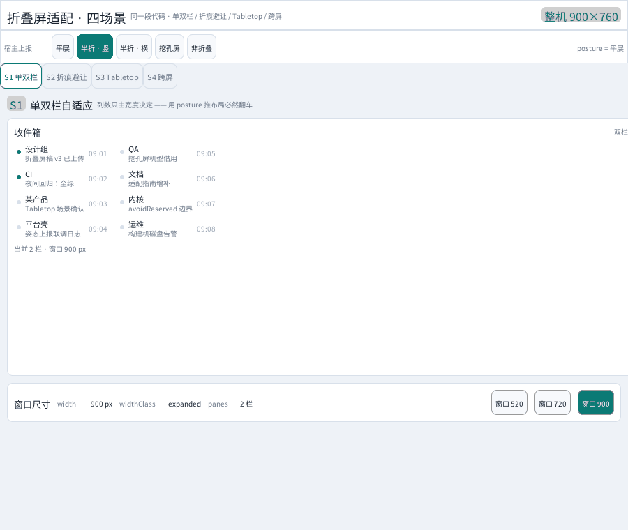

# foldable-demo —— 折叠屏适配演示（四场景）

一个窗口 900×760，顶部分形态栏、中间四个 Tab，一个 Tab 回答一个折叠屏适配的具体问题。
点 Tab 切场景，点形态按钮 = 往内核上报一次姿态，整页读数与布局同步变化。



> 上面这张 30 秒 GIF 由 `gfx/foldable_showcase_test.go` 真实跑出来：挂载本目录的
> `src/main.js` → 合成点击 → 抓真实帧 → 编成 GIF。不是手绘的示意图，文案由节点树
> 断言把关（`assertClipState`），状态不对就抓不到图。

## 四个场景

| 场景 | 回答的问题 | 关键 API |
|---|---|---|
| **S1 单双栏自适应** | 列数到底该信宽度还是信姿态？ | `panes(width)` + `widthClass()` / `useWindowInfo()` |
| **S2 折痕 / 挖孔避让** | 保留带要不要主动让开？谁来让？ | `useReservedRegions()` + 元素属性 `avoidReserved` |
| **S3 Tabletop** | 横折的上下两段怎么分工？ | `isTabletop(posture, hinge)`（**应用层组合判据**） |
| **S4 跨屏拖拽** | 窗口换物理屏时脚本能感知到什么？ | `screens()` / `screenOf()` / `onWindowDisplayChange()` |

### S1 单双栏自适应

列数**只由宽度决定**，不信姿态。上下折展开后宽度可能仍 < 600dp，拿 `posture()` 推布局
必然翻车（官方时序里尺寸变化还早于姿态变化，会落后一帧）。

场景内有「窗口 520 / 720 / 900」三个按钮，改的是**场景自己的宽度信号**，所以整棵子树
真的重新布局 —— 而不是只改一行文案。宽 < 600 单栏（列表＋详情上下叠），≥ 600 双栏
（左列表右详情）。

### S2 折痕 / 挖孔避让

`avoidReserved` 是 **opt-in**：内核元素默认不避让（老界面不会莫名位移）。折痕带只是
"分隔"，是否让开由应用决定。`<scroll>` 上不适用（会收缩滚动可用区、与滚动条语义打架，
内核忽略并告警）。

场景里左右并排两块面板做 A/B：左边不写属性（内容压在保留带上，暖色告警），右边写
`avoidReserved="all"`。上方按窗口坐标画了折痕位置标尺，切到「半折 · 竖」能看到橙色带
落在 440 处，切到「挖孔屏」能看到 64×64 的 occlusion 方块。

### S3 Tabletop（上预览 / 下操作台）

```js
// posture 枚举里没有 tabletop，也不该有 —— 它是 (姿态, 折痕方向) 的复合态。
export const isTabletop = (posture, hinge) =>
  posture === "half-open" && !!hinge && hinge.orientation === "horizontal";
```

判据写在 `src/lib/fold.js`（纯函数、零 import，可直接单测）。命中后上段当"显示屏"
（`height={340}` 的画面预览）、中间是横折痕带、下段是操作台（◀◀ / ❚❚ / ▶▶ + 画面计数）。
没命中时显示「当前不是 Tabletop」并给一个一键切到「半折 · 横」的按钮。

> ⚠️ **别用 `layoutMode().suggested === "tablet"` 判 Tabletop**。半折横向上报时
> `layoutMode().suggested` 仍然是 `"dual"`（宽度够双栏），拿它判会永远判不中。
> 旧的本目录代码正是这么写错的，Tabletop 那一档永远显示"当前不是 Tabletop"。
> 拍板记录见 [`01-native-host-spec-草案.md` §4.1](../../01-native-host-spec-草案.md)。

### S4 跨屏拖拽（窗口换物理屏）

基于已有的 `multiscreen_demo` / `router_window_demo` 基础设施，P1/P2 工作量。
**本场景说的是"窗口在两个物理显示器之间移动"**；半屏间（同一折叠设备左右两段之间）
的拖拽推 v2。

场景列出 `screens()` 的完整屏表、`screenOf(windowHandle())` 命中的屏 id、`bounds()` 的
窗口几何（含 `displayId`）、一张 1/8 缩放的屏布局示意（绿框 = 窗口所在屏），以及
`onWindowDisplayChange` 最近一条事件。点「左移 / 右移 160」移动窗口，跨过屏边界时
事件卡片会刷新成"换屏 A → B"。

> 无头环境造不出两块 RandR 显示器（`xrandr --setmonitor` 在这个 build 里不可用），
> 所以这条叙事靠 `screens()` / `screenOf()` / `bounds().displayId` 的读数与换屏事件来
> 演示，不是靠真拖。

## 运行

```bash
go build -o /tmp/gox-current ./cmd/gox
/tmp/gox-current apps/foldable-demo/src/main.js
```

把窗口拖窄到 600 以下，S1 会自动从双栏变单栏 —— 这份代码一个字都不用改。

## 生成演示物料

```bash
# 跑断言（不需要显示器）
go test ./gfx -run TestFoldableShowcase -v

# 跑断言 + 落盘 GIF/PNG 到 docs/foldable-demo/
GOX_FOLDABLE_SHOTS=1 go test ./gfx -run TestFoldableShowcase -v
```

产物：

| 文件 | 内容 |
|---|---|
| `docs/foldable-demo/foldable-30s.gif` | 10 帧 / 900×760 / **恰好 30000 ms**，四场景全覆盖 |
| `docs/foldable-demo/s1-narrow-single.png` | S1 单栏态 |
| `docs/foldable-demo/s2-occlusion-avoid.png` | S2 挖孔屏避让 A/B |
| `docs/foldable-demo/s3-tabletop.png` | S3 Tabletop 上预览下操作台 |
| `docs/foldable-demo/s4-cross-display.png` | S4 屏表 + 换屏事件 |

GIF 用**共享调色板 + 逐像素最近色映射**（不是每帧各自量化），所以帧间不闪；时间轴由
`showcaseClips` 的 hold 时长拼出来，测试里断言总长必须 = 30000ms，改帧就要改 hold。

## 结构

```
src/
  main.js        入口：渲染 900×760 窗口，setTimeout(0) 后再 bindWindow
  app.js         根组件 + 四个场景组件 + 形态栏 / Tab / 状态栏
  store.js       FORMS 五档形态 / reportPosture 上报 / 读数快照 / 事件日志
  theme.js       设计令牌（含折痕可视化色）
  lib/fold.js    纯逻辑：isTabletop / panes / 四种 text 格式化
```

## 压到的能力

| 能力 | API |
|---|---|
| 姿态读数 | `gx/screen` 的 `posture()` / `hinge()` / `hingeOrientation()` / `splitRatio()` / `regions()` |
| 姿态订阅 | `gx/screen` 的 `usePosture()` / `useWindowInfo()` / `screenOf()` |
| 姿态上报 | `gx/screen` 的 `reportPosture(opts)` / `resetDisplays()` |
| 多显示器 | `gx/screen` 的 `screens()` / `onWindowDisplayChange()` |
| 布局建议 | `gx/viewport` 的 `layoutMode()` / `widthClass()` / `hasFold()` / `reservedRegions()` |
| 断点订阅 | `gx/viewport` 的 `useBreakpoint()` / `useReservedRegions()` / `onViewportChange()` |
| 折痕避让 | 元素属性 `avoidReserved="division" \| "occlusion" \| "all"`（opt-in） |

## 四条纪律（本演示要传达的核心）

1. **布局只信宽度，不信姿态** —— `posture()` 变之前尺寸可能已经变了。
2. **订阅型读数先取再分支，别塞进三元** —— 两段式 `useXxx()()`：外层拿 getter，
   内层再调才订阅。首帧没走到的分支不建立订阅，effect 零依赖、永不重跑，界面就像"死"了一样。
3. **折痕/保留区坐标是显示器坐标** —— 全屏时等于窗口坐标，分屏/自由窗口下
   要减去窗口在屏上的原点。
4. **没人上报就恒为平展** —— 桌面/无头宿主没有折叠姿态查询 API（Windows 没有
   WinRT、X11 没有对应扩展）。框架的立场是**提供通道不猜姿态**；真机由平台壳工程
   上报（Android 的 `DisplayManager` / iOS 的 `UITraitCollection`），脚本写法完全一样。

## 这个 demo 顺手修掉的两个内核缺陷

跑通离线抓帧链路时踩出来的，都不是 demo 侧的问题：

1. **`reportPosture` 之后布局不重跑** —— `avoidReserved` 只在重绘时重算布局，而环境
   变更（`notifyEnvChanged`）没有把窗口标脏，导致"上报了姿态、避让没生效，要拖一下
   窗口才动"。修法：`gfx/screen.go` 的 `notifyEnvChanged()` 末尾加
   `markAllWindowsDirty()`。
2. **结构槽位收缩后留下残影** —— 切换分支时旧子树被拆掉，但它占的像素区域没进脏
   矩形，右侧会残留上一次的内容。修法：`gfx/node.go` 的 `wireReactiveChild` 在
   `runCleanups` 之前用 `subtreeBounds` 取旧盒子并 `markDirtyRectFor`。

## 已知限制

- 本演示自己扮演"宿主"：点形态按钮 = 往内核上报一次姿态。真机上这步由平台壳
  工程做，脚本侧读数写法不变。
- 首次上报必须带 `width` / `height`（+ `foldable`），否则"窗口所在显示器"解析不到，
  之后的姿态读了也是空的 —— 这是最容易踩的一条。本 demo 因此把 `bindWindow` 放在
  `setTimeout(..., 0)` 里：`reportPosture` 会同步回灌 VM，模块顶层直接调会把后面的
  模块代码整段吞掉。
- 应用退出时应调 `resetDisplays()` 把屏表交还后端；测试里对应
  `ResetDisplaysForTest()`。
- S4 的换屏叙事在无头环境里只有**单个**显示器，`onWindowDisplayChange` 不会真的
  触发；看到的是"左移/右移把窗口挤出屏边界"的读数变化。
